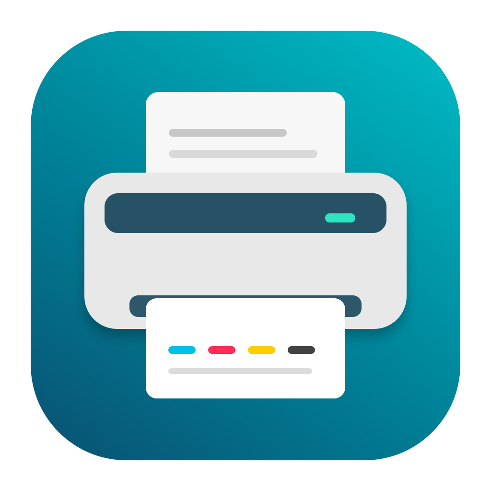

# Xerox Phaser 6010N per macOS

[English](README.md) · [Scarica il programma di installazione](https://github.com/antoniopisarra/xerox-phaser-6010-macos/releases/latest)



## Perché questo progetto?

La Xerox Phaser 6010N è una stampante ancora valida, ma il suo software originale appartiene a una generazione precedente di computer. Xerox offre driver per Windows e per vecchie versioni di macOS: quei pacchetti per Mac non forniscono una configurazione nativa Apple Silicon funzionante nell'ambiente provato per questo progetto. Lo scopo è portare la 6010N sui Mac moderni, con driver ARM64, applicazione grafica e programma di installazione completo, senza richiedere Terminale o Homebrew.

Il progetto è destinato ai Mac Apple Silicon delle famiglie **M1, M2, M3, M4, M5 e M6**, con **macOS 26 o successivo**. È il requisito dell'architettura ARM64: non significa che ogni modello o futura versione di macOS sia stato provato fisicamente. La stampa è stata verificata su un Mac Apple Silicon con versione del sistema riportata come macOS 26.6.2. La [pagina dei test](docs/TESTING.md) distingue le verifiche eseguite da quelle ancora necessarie. Per il supporto del produttore consulta i [download ufficiali Xerox](https://www.support.xerox.com/en-us/product/phaser-6010/downloads).

**È supportata esclusivamente la Phaser 6010N collegata tramite Ethernet.** Il Mac può essere connesso in Wi-Fi alla stessa rete locale. Questa versione non supporta USB, Mac Intel, altri modelli di stampante o AirPrint da iPhone/iPad.

## Installazione e prima stampa

1. Collega la stampante al router tramite cavo Ethernet e accendila.
2. Scarica `Driver-Xerox-Phaser-6010N-macOS-1.0.0.pkg` dalla pagina [Release](https://github.com/antoniopisarra/xerox-phaser-6010-macos/releases/latest), aprilo e completa l'installazione guidata.
3. Apri **Configura Xerox Phaser 6010N** dalla cartella **Applicazioni**.
4. Consenti l'accesso alla rete locale se macOS lo richiede. Seleziona la stampante trovata oppure inserisci il suo indirizzo IPv4, quindi aggiungi/aggiorna la stampante. macOS chiederà l'autorizzazione di un amministratore per configurare la coda.
5. Dal normale pannello di stampa scegli **Xerox Phaser 6010N**. Sono previsti A4 o Letter, carta normale, colori o scala di grigi, solo fronte.

Il pacchetto attuale **non ha firma Apple Developer ID e non è notarizzato**. L'app ha una firma ad hoc per l'integrità del contenuto, che non identifica uno sviluppatore verificato da Apple. Gatekeeper può bloccare il pacchetto scaricato: se ti fidi di questa release, usa la procedura macOS **Privacy e sicurezza → Apri comunque**, quando disponibile. Le regole di un Mac aziendale possono impedirlo. Non disattivare globalmente Gatekeeper. La notarizzazione è il controllo Apple per la distribuzione del software, distinto dal corretto funzionamento della stampa.

## Le tre sezioni dell'applicazione

- **Stampante:** ricerca in rete, inserimento manuale dell'IP, creazione/aggiornamento della coda e collegamento alle impostazioni stampanti di macOS.
- **Stato e toner:** stato della stampante e livelli ciano, magenta, giallo e nero; aggiornamento manuale e automatico ogni 30 secondi mentre la pagina è visibile; pagina web della stampante, impostazioni di condivisione ed esportazione della diagnostica.
- **Calibrazione:** foglio di centratura italiano/inglese, pulsante per stamparlo, spostamento orizzontale/verticale, correzione separata di larghezza/altezza e calcolo dalle misure rilevate sul foglio.

Le schermate reali dell'app saranno aggiunte dopo l'acquisizione sul Mac di prova. [Indicazioni per le tre immagini](docs/screenshots/README.md).

I livelli dei toner sono stime comunicate dalla stampante tramite SNMP: i valori sconosciuti restano non disponibili. Ricerca e stato richiedono UDP 161; la stampa usa TCP 9100. Se SNMP o la ricerca broadcast sono bloccati, inserisci l'IP manualmente; l'assenza dei livelli toner non impedisce la stampa. Lo stato usa l'utility `snmpget` fornita da macOS: se manca, l'app segnala lo stato non disponibile.

## Centratura e dimensioni

Apri **Calibrazione**, scegli **Italiano** o **English** e premi **Stampa foglio di centratura…**. Stampa su A4 al **100%**, senza adattamento alla pagina. Il PDF contiene un quadrato di 100 × 100 mm e una cornice a 10 mm dai bordi. Misura il foglio stampato, inserisci dimensioni e margini, calcola e salva le correzioni; ristampa per verificare.

Esempio: margine sinistro di 15 mm e destro di 5 mm richiedono uno spostamento di 5 mm a sinistra. Se il quadrato misura già 100 mm, la scala deve restare al 100%. X positivo sposta a destra; Y positivo verso il basso. Il calcolatore corregge i valori già applicati: usa misure ottenute con le impostazioni correnti. Spostamenti ammessi ±20 mm, scala 50–150%; le misure fuori intervallo vengono rifiutate. Correzioni elevate possono tagliare contenuti fuori dal foglio.

PDF: [Italiano](app/Resources/Centratura-it.pdf) · [English](app/Resources/Calibration-en.pdf).

## Aggiornamento, disinstallazione e condivisione

Installa il nuovo pacchetto sopra quello precedente: i componenti vengono aggiornati e la calibrazione locale conservata. **Disinstalla…** nell'app rimuove applicazione, driver, calibrazione e coda `Phaser6010`, inclusi i suoi lavori in attesa. Sono richieste conferma e autorizzazione amministratore.

Il pulsante di condivisione apre le impostazioni di macOS. La condivisione va abilitata dall'utente e richiede che il Mac rimanga acceso. Questa versione **non include un server AirPrint** e non dichiara stampa da iPhone/iPad. [Dettagli](docs/SHARING.md).

## Cosa è stato realizzato

Il progetto conserva l'encoder C `foo2hbpl1` già funzionante e corregge un accesso alla memoria alla fine della pagina. La pipeline Foomatic è stata sostituita da un filtro CUPS dedicato: Ghostscript autonomo converte PDF/PostScript in raster a 600 dpi e l'encoder produce HBPLv1. Il pacchetto include Ghostscript, font, profili colore, sorgenti originali e licenze, senza dipendere da Homebrew o modificare un Ghostscript di sistema.

Sono stati corretti la gestione dei file temporanei nel sandbox di stampa e l'adattamento forzato dei PDF che ingrandiva le pagine. Le correzioni di calibrazione vengono applicate una volta per pagina. L'utility nativa AppKit aggiunge ricerca di rete, configurazione della coda, toner, diagnostica con dati ridotti, fogli bilingui e icona. L'installer impedisce che una vecchia copia di sviluppo dell'app intercetti l'installazione.

La stampa usa l'interfaccia legacy PPD/filtro di CUPS disponibile nella versione macOS provata. Una IPP Printer Application è una possibile evoluzione futura, non inclusa. Cambiamenti futuri del sistema di stampa macOS potrebbero richiedere aggiornamenti.

## Sorgenti, compilazione e verifiche

Per sviluppare servono un Mac Apple Silicon e Xcode/Command Line Tools; per installare basta il pacchetto. La documentazione tecnica è in inglese: [compilazione](docs/BUILD.md), [architettura](docs/ARCHITECTURE.md), [test](docs/TESTING.md), [release](docs/RELEASE.md).

```sh
./scripts/fetch-ghostscript.sh
./packaging/build-ghostscript.sh
./tests/core.sh
python3 tests/encoder-memory.py
GS_EXECUTABLE="$PWD/vendor/ghostscript/bin/gs" ./tests/smoke.sh
./packaging/package.sh
```

La release offre anche un archivio completo dei sorgenti corrispondenti, compreso Ghostscript nella versione fissata, per ricompilarlo offline. Gli script registrano URL e SHA-256. Per rigenerare PDF e icona servono anche Python con ReportLab e gli strumenti Swift Apple; le risorse generate sono già nel repository.

## Progetto di origine

L'encoder deriva dal progetto Linux **[foo2zjs / foo2hbpl1](https://github.com/OpenPrinting/foo2zjs)**. Non è stato riscritto da zero: questo port conserva il lavoro degli autori originali e aggiunge la pipeline, il pacchetto e l'utility per macOS. I sorgenti ricevuti attribuiscono il lavoro a **Robert Szalai, Rick Richardson, Dave Coffin e Joe Da Silva**. Grazie a loro per aver reso possibile la stampa HBPLv1 open source.

La base effettivamente utilizzata è la cartella `foo2zjs-macos` fornita dall'autore del port, con le modifiche HBPLv1 annotate nel suo ChangeLog. Non disponendo della cronologia Git originale, non attribuiamo questa copia a un commit upstream non verificato. [Provenienza e modifiche](docs/UPSTREAM.md).

## Licenze e riconoscimenti

Progetto indipendente, non affiliato né approvato da Xerox. Xerox e Phaser sono marchi dei rispettivi titolari. Non sono inclusi driver proprietari o firmware Xerox.

- Encoder e nuovo codice: **GPL-2.0-or-later**, testo in [LICENSE](LICENSE). Autori e avvisi originali restano nel [codice](src/foo2hbpl1.c); è conservata anche una [copia originale](vendor/original-encoder/foo2hbpl1.c).
- Ghostscript/GhostPDL 10.08.0: **AGPL-3.0-or-later**, Artifex e collaboratori. L'opzione GPL «o successiva» permette l'uso sotto GPLv3 quando necessario per la compatibilità con AGPLv3; Ghostscript non va presentato come GPLv2-only.
- Font e librerie conservano le proprie licenze: [inventario](vendor/THIRD-PARTY-NOTICES) e archivio completo. Dopo l'installazione `/Library/Printers/Phaser6010/licenses` contiene sorgenti, istruzioni di compilazione e testi delle licenze.

Grazie agli autori di foo2hbpl1/foo2zjs, ai collaboratori Ghostscript e a chi ha provato la stampante reale. La manutenzione è volontaria. Nelle segnalazioni indica versione macOS, famiglia del chip, collegamento e rapporto diagnostico dell'app. Evita documenti personali e log di stampa non ripuliti.
